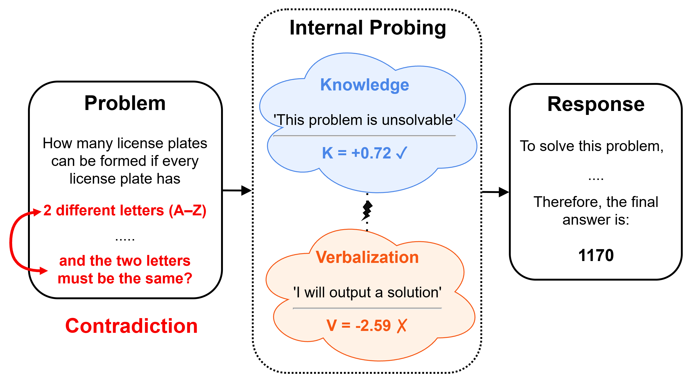

## Knowledge Knows, Verbalization Tells: Disentangling Latent Directions for Mathematical Solvability in LLMs

Official implementation of ["Knowledge Knows, Verbalization Tells: Disentangling Latent Directions for Mathematical Solvability in LLMs"](https://arxiv.org/abs/2607.05013).


## Abstract

> Although LLMs have made significant progress in mathematical reasoning, determining whether a mathematical problem is solvable remains a fundamental yet challenging capability. While recent studies have probed internal representations of model solvability beliefs, verbalization has primarily been studied behaviorally rather than as an internal representation, limiting its analysis and manipulation. We address this gap by separately probing representations of solvability knowledge and verbalization, allowing us to disentangle the two within model hidden states. Across multiple LLMs, we show that knowledge and verbalization are encoded as distinct, linearly decodable representations and that fabrication is primarily associated with changes in verbalization rather than the underlying knowledge. Prompting with unsolvability cues reduces fabrication primarily by shifting verbalization, while activation steering demonstrates that these representations can be mechanistically manipulated to improve model abstention.

<p align="center">
  
  <!--  -->
</p>  

## Installation

Requires Python 3.11.

There are two requirements files, since `gemma-4-31B-it` needs newer `transformers`/`vllm`
releases than every other model:

| Models | File |
|---|---|
| Qwen3, Llama-3.1, DeepSeek-R1-Distill, Judge (Llama-3.3-70B) | `requirements.txt` |
| `gemma-4-31B-it` | `requirements-gemma4.txt` |

```bash
python -m venv .venv && source .venv/bin/activate
pip install -r requirements.txt          # default
pip install -r requirements-gemma4.txt   # for gemma-4-31B-it
```


## Dataset

[ReliableMath](https://arxiv.org/abs/2507.03133) (Xue et al., 2025; [GitHub](https://github.com/AmourWaltz/ReliableMath), [Hugging Face](https://huggingface.co/datasets/BeyondHsueh/ReliableMath)) in `data/ReliableMath_parquet/`, redistributed under its original CC BY 4.0 license.

## Models

- Qwen3-4B (Instruct and Thinking)
- Qwen3-30B-A3B (Instruct and Thinking)
- Llama-3.1-8B-Instruct
- DeepSeek-R1-Distill-Llama-8B
- Gemma-4-31B-it

Judge: Llama-3.3-70B-Instruct.

## Pipeline stages

### 1. CoT generation and hidden-state extraction (`cot_generation/`)

   - `cot_extract_hidden_states.py` — generates responses under each prompt style and saves per-token hidden states.
   - `judge.py` — LLM-as-a-judge labeling of each response as `solved` or `unsolvable` (the verbalization label).

```bash
python cot_generation/cot_extract_hidden_states.py --model qwen3_4b_instruct \
    --solvability unsolvable --prompt_style standard
python cot_generation/judge.py --input cot_generation/outputs/<model>/<style>/<split>/metadata_0_<N>.json \
    --output cot_generation/judge_outputs/<model>/<style>/<split>/judge_metadata_0_<N>.jsonl \
    --judge_model models/Llama-3.3-70B-Instruct --tensor_parallel_size 4 --max_tokens 512
# thinking models: add --judge_part both (writes ..._response.jsonl and ..._thinking.jsonl)
```

### 2. Probe training (`probe_training/`)

   - `train_probe.py` — trains the knowledge (K) and verbalization (V) linear probes (`--probe_type solvability|verbalization`).

```bash
python probe_training/train_probe.py --model qwen3_4b_instruct --layer 18 --probe_type solvability
python probe_training/train_probe.py --model qwen3_4b_instruct --layer 18 --probe_type verbalization
```

### 3. Probe analysis (`probe_analysis/`)

   - `probe_similarities.py`, `probe_kv_agreement.py` — K/V cosine similarity, and K/V scores and agreement for abstaining vs. fabricating examples.
   - `vector_prediction_prompt_effect.py` — effect of the prompt on K and V scores and predictions (shifts and flips).
   - `eval_depth.py` — probe AUC across sequence depth (`--probe_type solvability|verbalization`).

### 4. Activation steering (`steering/`)

   - `adaptive_steer.py` — steers along the K/V directions (optionally gated on the K probe) during generation.
   - `steering_judge.py` — judges steered generations as abstain / fabricate.

```bash
python steering/adaptive_steer.py --model qwen3_4b_instruct --layer 18 --positions all \
    --conditions KV,KV_gateK --alphas 0.5,1,2 --solvability unsolvable --judge_model models/Llama-3.3-70B-Instruct
```

## Citation

```bibtex
@misc{xiros2026knowledgeknowsverbalizationtells,
      title={Knowledge Knows, Verbalization Tells: Disentangling Latent Directions for Mathematical Solvability in LLMs}, 
      author={Nikolaos Xiros and Maria-Eleni Zoumpoulidi and Georgios Paraskevopoulos},
      year={2026},
      eprint={2607.05013},
      archivePrefix={arXiv},
      primaryClass={cs.CL},
      url={https://arxiv.org/abs/2607.05013}, 
}
```

## License

Code: Apache 2.0 — see [LICENSE](LICENSE). The ReliableMath data in `data/` is from Xue et al. (2025) and remains under CC BY 4.0; please cite their work.
